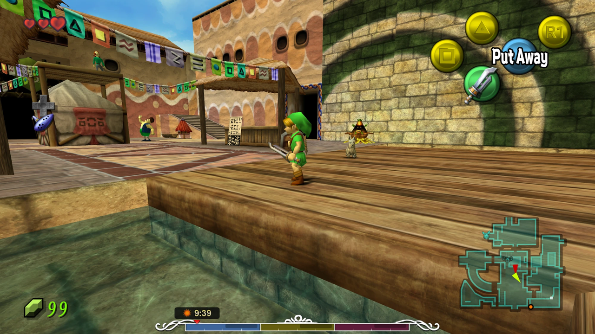
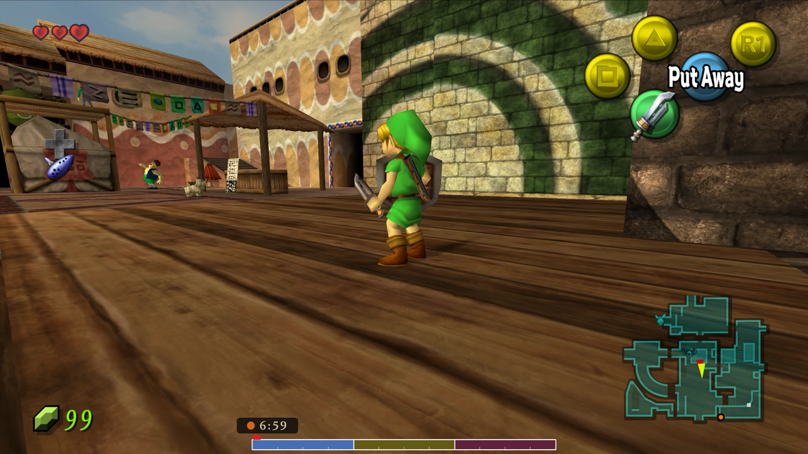

# 3DS Clock

A [Zelda 64: Recompiled](https://github.com/Zelda64Recomp/Zelda64Recomp) mod for *Majora's Mask* that replaces the N64 three-day clock with the clock from *Majora's Mask 3D*.

[English](#english) · [Français](#français)

| With the MM3D 4K textures | Without textures |
|---|---|
|  |  |

---

## English

### Features

- **Three-day bar** at the bottom of the screen, with the current day highlighted and the other days dimmed.
- **Cursor** that moves along the bar from 6:00 on the first day to 6:00 after the final day.
- **Time bubble** above the cursor, with the sun (6:00–18:00) or the moon and the time in 12-hour format. The bubble gently pulses (about every 2.3 seconds).
- **Slowed time** (Inverted Song of Time): gold outline, cyan digits and the slowed-time arrow, as on 3DS.
- **Final hours**: an `HH:MM:SS` countdown (real in-game seconds) replaces the bubble.
- Same visibility rules as the original clock (hidden during dialogue, pause, stopped time, after day 3) and same HUD fades.

To get the original clock back, disable the mod.

### Installation

1. Download `3DS_Clock-<version>.zip` from the [Releases](../../releases) page.
2. Drag and drop it onto the Zelda 64: Recompiled window.
3. Enable **3DS Clock** in the **Mods** menu.

The mod works as is, with a clock drawn without textures (right-hand picture above).

### Getting the 3DS look (optional, no compiling)

The 3DS pieces come from **Henriko Magnifico's MM3D 4K texture pack**. They are not redistributable, so the mod cuts them out of your own copy of the pack.

1. Get the pack from its author: **[Zelda Majora's Mask 3D 4K — Henriko Magnifico](https://henrikomagnifico.com/zelda-majoras-mask-3d-4k)** (follow the download link on that page; recent versions are distributed through his Patreon) and extract it anywhere.
2. In the game, open **Mods** → **3DS Clock** → **Configure**.
3. In **Texture pack folder (MM3D 4K)**, enter the path of the pack folder, for example:
   ```
   C:\Users\Me\Desktop\MM3D 4K
   ```
   On Linux or macOS, `~/MM3D 4K` works too.
   The mod finds the file it needs by itself (`user/load/textures/0004000000125500/UI/tex1_512x256_45D746278BB3DA8A_13_mip0.png`, about 2 MB). You can also give the path of that file directly. Quotes (from *Copy as path*) are fine.
4. Confirm: the clock switches to the 3DS look within a second or two.

Leave the field empty to keep the clock without textures. If the path is wrong or the file isn't the expected 4096×2048 image, the clock also stays without textures.

### Compatibility

- **Windows, Linux and macOS**: the textures are cut by a small native library shipped in the zip (`clock3ds_textures.dll` for Windows, `.so` for Linux x64, `.dylib` for macOS). The game loads the one for your system and refuses to load the mod without it, even if you don't use the textures. On **Linux ARM64**, replace `clock3ds_textures.so` in your mods folder with `clock3ds_textures-linux-arm64.so` from the release, renamed to `clock3ds_textures.so`.
- Replaces `Interface_DrawClock` with `RECOMP_PATCH`: not compatible with another mod that patches the same function.
- Works with the Archipelago randomizer ([MMRecompRando](https://github.com/RecompRando/MMRecompRando)) and with time-speed mods: everything is computed from the in-game time.
- Works with *Better Double SoT*: its hour-selection preview is shown on the bar (choosing 6:00 points to the next day's dawn).
- With *Better Double SoT* on day 3, the hour cursor stops at 23:00, and when the proposed hour is after midnight the answer is locked on *No*: choosing an hour in the final hours crashes the game (the vanilla game refuses the Song of Double Time on the night of day 3).
- Requires Zelda 64: Recompiled 1.2.2 or newer.

### Building

Requirements:
- `make`, a MIPS-capable `clang` and `ld.lld`, and `RecompModTool` from [N64Recomp](https://github.com/N64Recomp/N64Recomp) for the mod;
- for the native library: Visual Studio Build Tools (x64 C++) on Windows, a C++17 compiler on Linux / macOS.

```bash
git clone --recurse-submodules <this repository>
cd mm-recomp-3ds-clock
make
RecompModTool mod.toml build
native\build.bat        # Windows
sh native/build.sh      # Linux, macOS
```

Copy `build/nelem_mm_clock_3ds.nrm` and the library (`build/clock3ds_textures.dll`, `.so` or `.dylib`) into your mods folder.

The [Native library](.github/workflows/native.yml) workflow builds the library for every platform and checks that they all cut the same pieces from a synthetic test atlas.

`native\build.bat test` (or `sh native/build.sh test`) also builds `clock3ds_textures_test <atlas or pack folder> <output folder>`, which writes every piece as raw RGBA to check the cutting.

### How it works

- `Interface_DrawClock` keeps the original visibility conditions and HUD alpha, but updates a `recompui` overlay instead of drawing the N64 clock.
- When the overlay is created, and whenever the *Texture pack folder* setting changes, the mod passes the path to the native library. The library ([native/clock3ds_textures.cpp](native/clock3ds_textures.cpp)) finds the atlas, reads it with [stb_image](https://github.com/nothings/stb), cuts the 46 pieces, halves them (Lanczos), recolours the digits, then copies each piece into game memory, where `recompui_create_texture_rgba32` turns it into a texture.
- Without the atlas, the same layout is built from `recompui` boxes and labels.
- The overlay is only updated when a value changes.
- `Interface_Draw` and `Play_Destroy` hooks hide the overlay whenever the clock isn't drawn (pause, menus, title screen).

### License

Code: [CC0 1.0](LICENSE) — public domain. Based on the [MMRecompModTemplate](https://github.com/Zelda64Recomp/MMRecompModTemplate) (CC0) and the [zeldaret/mm](https://github.com/zeldaret/mm) decompilation. [stb_image](native/stb_image.h) by Sean Barrett (public domain / MIT).
The textures come from Nintendo's artwork and Henriko Magnifico's texture pack. They are **not** included, and are not covered by this license.

---

## Français

### Fonctionnalités

- **Barre des trois jours** en bas de l'écran : le jour en cours en pleine couleur, les autres assombris.
- **Curseur** qui avance de 6:00 le premier jour jusqu'à 6:00 après le dernier jour.
- **Bulle de l'heure** au-dessus du curseur : soleil (6:00–18:00) ou lune, heure au format 12 h. La bulle pulse doucement (environ toutes les 2,3 secondes).
- **Temps ralenti** (Chant du Temps inversé) : contour doré, chiffres cyan et flèche, comme sur 3DS.
- **Dernières heures** : compte à rebours `HH:MM:SS` (vraies secondes de jeu) à la place de la bulle.
- Mêmes règles d'affichage que l'horloge d'origine (cachée pendant les dialogues, la pause, le temps arrêté, après le jour 3) et mêmes fondus du HUD.

Pour retrouver l'horloge d'origine, désactive le mod.

### Installation

1. Télécharge `3DS_Clock-<version>.zip` dans les [Releases](../../releases).
2. Glisse-le dans la fenêtre de Zelda 64: Recompiled.
3. Active **3DS Clock** dans le menu **Mods**.

Le mod marche tel quel, avec une horloge dessinée sans textures (image de droite en haut de la page).

### Avoir le rendu 3DS (facultatif, sans rien compiler)

Les pièces 3DS viennent du **pack de textures MM3D 4K de Henriko Magnifico**. Elles ne peuvent pas être redistribuées : le mod les découpe dans ta propre copie du pack.

1. Récupère le pack chez son auteur : **[Zelda Majora's Mask 3D 4K — Henriko Magnifico](https://henrikomagnifico.com/zelda-majoras-mask-3d-4k)** (lien de téléchargement sur cette page ; les versions récentes sont distribuées via son Patreon) et décompresse-le où tu veux.
2. Dans le jeu, ouvre **Mods** → **3DS Clock** → **Configure**.
3. Dans **Texture pack folder (MM3D 4K)**, entre le chemin du dossier du pack, par exemple :
   ```
   C:\Users\Moi\Desktop\MM3D 4K
   ```
   Sous Linux ou macOS, `~/MM3D 4K` marche aussi.
   Le mod trouve tout seul le fichier dont il a besoin (`user/load/textures/0004000000125500/UI/tex1_512x256_45D746278BB3DA8A_13_mip0.png`, environ 2 Mo). Tu peux aussi donner directement le chemin de ce fichier. Les guillemets (*Copier en tant que chemin*) sont acceptés.
4. Valide : l'horloge passe au rendu 3DS en une ou deux secondes.

Laisse le champ vide pour garder l'horloge sans textures. Si le chemin est faux ou si le fichier n'est pas l'image attendue (4096×2048), l'horloge reste aussi sans textures.

### Compatibilité

- **Windows, Linux et macOS** : les textures sont découpées par une petite bibliothèque native fournie dans le zip (`clock3ds_textures.dll` pour Windows, `.so` pour Linux x64, `.dylib` pour macOS). Le jeu charge celle de ton système et refuse de charger le mod sans elle, même si tu n'utilises pas les textures. Sous **Linux ARM64**, remplace `clock3ds_textures.so` dans le dossier mods par `clock3ds_textures-linux-arm64.so` de la release, renommé en `clock3ds_textures.so`.
- Remplace `Interface_DrawClock` (`RECOMP_PATCH`) : incompatible avec un autre mod qui modifie la même fonction.
- Compatible avec le randomizer Archipelago et avec les mods qui changent la vitesse du temps.
- Avec *Better Double SoT*, le jour 3, le curseur d'heure s'arrête à 23:00, et si l'heure proposée est après minuit la réponse est bloquée sur *Non* : choisir une heure dans les dernières heures fait crasher le jeu.
- Nécessite Zelda 64: Recompiled 1.2.2 ou plus récent.

### Compilation

Voir la section [Building](#building) ci-dessus.

### Licence

Code : [CC0 1.0](LICENSE) — domaine public. [stb_image](native/stb_image.h) de Sean Barrett (domaine public / MIT).
Les textures viennent des graphismes de Nintendo et du pack de Henriko Magnifico : elles ne sont **pas** incluses et ne sont pas couvertes par cette licence.
